# KubeHarness — Concept and Planning Baseline

> **Document status:** Proposed system concept. S0 to S2 are implemented; S3 slices 0 to 3 are implemented; everything from S3 slice 4 on is still a proposal.  
> **Last reviewed:** 2026-11-07.  
> **Audience:** Maintainer, reviewers, contributors, and pstack planning agents.  
> **Source of truth for:** Product boundary, accepted direction, candidate requirements, lifecycle and platform architecture, verification experiments, success measures, and open questions.  
> **Companion:** [README.md](README.md) provides the public-facing introduction.

## 1. Executive concept

**KubeHarness is a proposed Go-native platform integration testing harness for owned, disposable Kubernetes environments.** It should let an engineer test the behavior of a real application *through its deployed platform topology* rather than validate only manifests, mock external boundaries, or maintain a shared test cluster.

A test may need to create an ephemeral cluster; install a Gateway API controller, service mesh, and/or other components; deploy PostgreSQL or Redis; perform schema migrations; deploy services; await readiness; call an HTTP or MCP endpoint; verify observable behavior; collect failure evidence; and tear everything down. The harness coordinates those steps while the application team owns application-specific configuration and assertions.

**Product promise:** *Describe the behavior you expect. KubeHarness manages the test environment and produces the evidence.*

**Positioning:** Platform integration testing, not a general-purpose Kubernetes provisioning tool, Gateway API conformance suite, generic CI orchestrator, database framework, AI agent framework, or LLM answer-quality evaluator.

### Why this project is separate from kubecheck

The prior [kubecheck](https://github.com/ogarciacar/kubecheck) project demonstrated embedding Kind cluster provisioning in Go tests. Its review identified lifecycle gaps (partial failure cleanup, ignored cleanup errors, fixed readiness waits, brittle port assertions), an outdated README, and tight coupling of package tests to Docker. KubeHarness starts in a **new repository**, with no promise of import/API compatibility and no code automatically reused. kubecheck may be retired later as a separate action, not as a prerequisite or automatic deletion.

The larger opportunity is moving from **cluster provisioner** to **behavior-oriented test harness**, without building a generic infrastructure platform.

## 2. Decisions and boundaries

These are the **agreed direction** from concept discussions. Detailed contracts remain subject to pstack design review and implementation evidence.

Each decision has an Architecture Decision Record in `docs/adr/` ([D27](docs/adr/0027-record-architecture-decisions.md)). This table is the index. [docs/adr/README.md](docs/adr/README.md) explains how to add or supersede a decision.

| ID | Decision | Status |
| --- | --- | --- |
| [D01](docs/adr/0001-start-in-an-independent-repository.md) | Begin in the independent `ogarciacar/kubeharness` repository | Accepted |
| [D02](docs/adr/0002-go-library-on-standard-testing-t.md) | Go-first library using standard `testing.T` workflows | Accepted |
| [D03](docs/adr/0003-own-ephemeral-kind-clusters.md) | KubeHarness provisions and **owns ephemeral Kind clusters** in v1.x | Accepted |
| [D04](docs/adr/0004-defer-existing-clusters-to-v2-0-0.md) | **No tests against existing staging clusters in v1.x** | Accepted |
| [D05](docs/adr/0005-gateway-api-as-the-gateway-resource-model.md) | **Kubernetes Gateway API** is the default gateway resource model | Accepted |
| [D06](docs/adr/0006-envoy-gateway-as-the-default-gateway-api-controller.md) | **Envoy Gateway** is the default Gateway API controller | Accepted |
| [D07](docs/adr/0007-agentgateway-gets-its-own-profile.md) | Agentgateway gets its **own optional controller profile**; do not automatically install Envoy Gateway beside it | Accepted |
| [D08](docs/adr/0008-agent-router-extends-envoy-gateway.md) | Agent Router profile **extends Envoy Gateway** | Accepted |
| [D09](docs/adr/0009-profile-priority.md) | Profile priority: `minimal`, `gateway-api` P0; `gateway-agentgateway` P1; `mesh-istio` and `gateway-agent-router` P2 | Accepted |
| [D10](docs/adr/0010-real-dependencies-and-local-mocks.md) | Actual dependencies and deterministic local mocks, not live paid LLM APIs, for reference tests | Accepted |
| [D11](docs/adr/0011-verify-controller-state-and-data-plane.md) | Tests verify both **controller/resource state** and **data-plane behavior** | Accepted |
| [D12](docs/adr/0012-cleanup-and-diagnostics-are-core.md) | Cleanup, diagnostics, cancellation and failure preservation are core, not afterthoughts | Accepted |
| [D13](docs/adr/0013-go-library-only-no-cli-or-schema.md) | Only an initial, appropriately scoped **Go library** is assumed; CLI, YAML schema and plug-in SDK are *not* committed | Proposed |
| [D14](docs/adr/0014-pin-profile-versions.md) | Explicit profile version compatibility and pinned test images/dependencies | Accepted |
| [D15](docs/adr/0015-drive-kind-through-its-go-library.md) | Drive Kind through its Go library, not the `kind` CLI | Accepted |
| [D16](docs/adr/0016-one-owned-cluster-per-test.md) | One owned cluster per test, created by `New(t)` and deleted in `t.Cleanup`. Methods must be called from the test that created the `Harness` | Accepted |
| [D17](docs/adr/0017-docker-picks-the-api-server-port.md) | Docker picks the API server port (kind `apiServerPort: -1`) | Accepted |
| [D18](docs/adr/0018-deadlines-end-before-the-go-test-timeout.md) | Setup and every operation end by `-timeout` minus the cleanup budget and a 5s margin. A watchdog disposes of the cluster early if the test body overruns | Accepted |
| [D19](docs/adr/0019-truthful-cleanup-reports.md) | Cleanup is `succeeded` only from a listing taken after `Create` returned; `failed` only from a listing after the latest Delete that still shows the cluster; otherwise `uncertain`. `failed` and `uncertain` fail the test with a Docker-only remove command | Accepted |
| [D20](docs/adr/0020-server-side-apply-and-loopback-port-forward.md) | Server-side apply through client-go, and host access through client-go port-forward on loopback only | Accepted |
| [D21](docs/adr/0021-load-local-images-never-build-or-pull.md) | The library loads locally built images and never builds or pulls them | Accepted |
| [D22](docs/adr/0022-examples-in-their-own-modules-with-baselines.md) | Examples live in their own Go modules next to a plain kind + kubectl + Go baseline of the same scenario | Accepted |
| [D23](docs/adr/0023-reject-kgateway-for-the-gateway-api-profile.md) | kgateway was considered and rejected as the `gateway-api` controller; Envoy Gateway stays (D06) | Accepted |
| [D24](docs/adr/0024-install-gateway-api-crds-separately.md) | The harness installs the Gateway API CRDs as their own pinned layer before any controller, never through a controller chart | Accepted |
| [D25](docs/adr/0025-resolve-the-gateway-address-from-gateway-status.md) | Gateway traffic resolves its address from the `Gateway` resource's status, and gateway experiments take their `GatewayClass` from the profile | Superseded by [D31](docs/adr/0031-reach-a-gateway-through-its-status-address-and-a-port-forward.md) |
| [D26](docs/adr/0026-agentgateway-uses-its-own-controller.md) | `gateway-agentgateway` installs agentgateway's own controller (v1.0 or later, `controllerName` `agentgateway.dev/agentgateway`, charts under `cr.agentgateway.dev/charts`) | Accepted |
| [D27](docs/adr/0027-record-architecture-decisions.md) | Record each architecture decision as an ADR in `docs/adr/`, indexed by this table | Accepted |
| [D28](docs/adr/0028-gateway-profiles-are-typed-values-installed-after-new.md) | Gateway profiles are opaque typed values such as `EnvoyGateway()`, installed after an unchanged `New(t)` with `h.InstallGateway(p)`, which returns a typed `*GatewayController`; one profile per cluster | Accepted |
| [D29](docs/adr/0029-render-profile-manifests-offline-and-embed-them.md) | Profile manifests are rendered offline from pins with the Helm SDK in `hack/render`, embedded, and applied with server-side apply; no Helm or network for manifests at test time | Accepted |
| [D30](docs/adr/0030-gateway-api-tested-combination.md) | The `gateway-api` tested combination is kind v0.33.0 with Kubernetes v1.37.0 (outside Envoy Gateway's published range, kept while it passes), Gateway API v1.6.1 standard channel, and Envoy Gateway v1.9.3 | Accepted |
| [D31](docs/adr/0031-reach-a-gateway-through-its-status-address-and-a-port-forward.md) | `GatewayController.Gateway(ref)` resolves the Gateway's status `IPAddress` to exactly one ClusterIP Service and opens one loopback port-forward per listener port; the dialer ignores the URL host and re-forwards the same Service once within `forwardTimeout`; no `sigs.k8s.io/gateway-api` dependency | Accepted |
| [D32](docs/adr/0032-namespaced-refs-and-delete-for-referencegrant.md) | `WaitReady` and `Forward` take `"namespace/name"` (bare name still means `default`); `Harness.Delete(dir)` removes manifests in reverse Apply order until each GET is `NotFound`; G02 proves ReferenceGrant deny, grant, allow, and revoke without a `sigs.k8s.io/gateway-api` dependency | Accepted |

**Clarification:** The Kubernetes **Gateway API is an API specification**, not a built-in gateway data plane. Using a “native Gateway API” does not remove the need for a controller/proxy. Envoy Gateway is the initial default implementation.

### Out of scope in v1.x

- Targeting, changing, or inspecting pre-existing staging/production Kubernetes clusters as test targets; include the *analysis and ownership model* only in v2.0.0 planning.
- Real cloud parity claims (load balancers, multi-zone resilience, managed databases, cloud identity or storage durability); a local Kind topology verifies selected behavior, not complete production equivalence.
- Multi-cluster orchestration, fleet management, remote environment reservations, or shared cluster tenancy.
- General Gateway API conformance certification, gateway implementation development, or replacing upstream test suites.
- A full test DSL, remote hosted service, dashboard, generic plugin marketplace or mandatory YAML test framework.
- LLM answer scoring, prompt evaluation, reasoning assessment, or agent task-quality benchmarking. Those concerns belong to tools such as evalkit; KubeHarness tests connectivity and platform behavior.
- Automatically provisioning external cloud providers, identity systems or paid model endpoints for baseline tests.

## 3. System context and success boundary

### Actors

- **Application developer:** Defines workload/dependency fixtures, triggers Go tests, asserts behavior.
- **Platform / DevEx engineer:** Defines platform profiles and platform policy experiments.
- **CI runner:** Provides a host with the required container runtime/resources, runs tests, and retains reports.
- **Maintainer / pstack:** Reviews requirements, designs slices, updates architecture and acceptance evidence.

### External systems and dependencies

- Host OS and Docker-compatible runtime; Kind creates a Kubernetes cluster in containers.
- Kubernetes API server and controllers; Gateway API CRDs where needed.
- Optional Envoy Gateway, Agentgateway, Istio, Agent Router, PostgreSQL, Redis, mock HTTP/LLM/MCP services.
- Helm/manifests/OCI images, local networking, container image registry or an explicitly preloaded image cache.
- Go's `testing` lifecycle and CI artifact storage.

### Observable outputs

- Application/platform assertions with pass/fail status and reproducible inputs.
- Cluster/profile/workload readiness or reconciliation observations.
- Failure classification and supporting evidence (logs, events, resource status, protocol traces where safe).
- Infrastructure cleanup outcome reported separately from test outcome.
- Reproducibility, timing, resource usage and developer-effort measurements for framework validation.

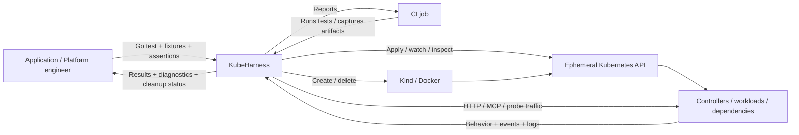

**System completion criterion:** For a chosen scenario, a developer can identify the owned environment, expected behavior, observed outcome, failure evidence, and cleanup result without operating a shared Kubernetes environment by hand.

## 4. Required capabilities (candidate contracts)

These describe **intended behavior**, not final public types or signatures.

| ID | Capability | Candidate observable acceptance contract |
| --- | --- | --- |
| F01 | Ephemeral cluster ownership | Harness creates a uniquely identified Kind cluster and tracks every allocated resource |
| F02 | Profile preparation | Profile prerequisites/compatibility checked; dependencies installed in a deterministic order; readiness observed |
| F03 | Workload setup | Apply declared Kubernetes resources and/or pinned Helm releases; associate resources with the current scenario |
| F04 | Dependencies | Run services such as PostgreSQL, Redis, mock LLMs and MCP backends with explicit readiness and schema/seed steps |
| F05 | Waiting/observation | Observe Jobs, Deployments, Pods, Gateway API conditions, controller health, and test-specific usable readiness without fixed sleeps |
| F06 | Network access | Resolve a reachable endpoint (via controlled forwarding or mapping) and inject protocol traffic without assuming a cloud LoadBalancer |
| F07 | Assertions | Support caller-authored Go assertions over actual HTTP/MCP responses, resource state and backend effects |
| F08 | Failure diagnostics | Capture bounded, structured evidence before cleanup when setup, execution or teardown fails |
| F09 | Teardown | Attempt idempotent, deadline-bounded cleanup after *any* failure, preserving original errors and cleanup errors |
| F10 | Cancellation | Respect context deadlines and Go test cleanup semantics, never block indefinitely on a non-responsive resource |
| F11 | Isolation | Prevent unintentional collisions in names, ports, namespaces, test data and gateway/global policy resources |
| F12 | Reports | Preserve separate verification, environment, diagnostics and cleanup outcomes for local and CI use |
| F13 | Version pinning | Record Kind/node image, Kubernetes, controller/Helm/CRD and fixture versions (and image digests if possible) |

### Nonfunctional expectations

- **Predictability:** fixed seed/test inputs and explicit versions; repeat runs with recorded environment metadata.
- **Resource safety:** no leaked owned clusters after expected failure modes; cleanup errors cannot be silently dropped.
- **Diagnostic fidelity:** distinguish unreachable API, reconciliation failure, unready workload, denied request, application assertion failure, timeout, and cleanup failure.
- **Boundedness:** configurable deadlines on cluster setup, workload readiness, execution, diagnostics and teardown.
- **Compatibility:** check Kubernetes/CRD/controller versions before installing an incompatible profile.
- **Security:** use test-only credentials; redact Secrets, tokens, authorization headers and private payloads from artifacts; no unsafe automatic deletion of unknown resources.
- **Simplicity:** baseline does not require external accounts, paid models or an always-on service.
- **Runtime efficiency:** compare cold vs warm setup, but don't sacrifice correctness for premature shared-cluster reuse.

## 5. Architecture and internal boundaries

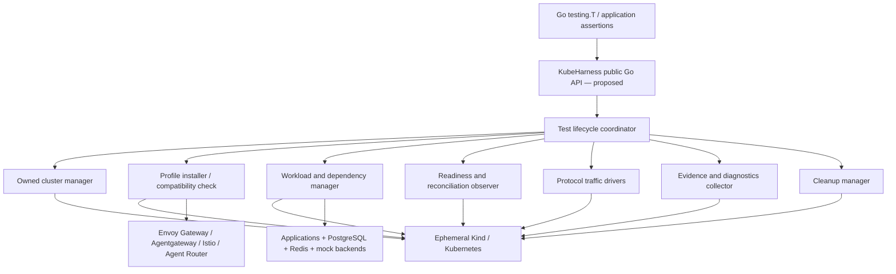

### Separation of responsibility

| Component | Owns | Does **not** own |
| --- | --- | --- |
| Cluster manager | Create/delete, lifecycle ID, kubeconfig, host access, allocated resources | Workload business semantics |
| Profile manager | CRD/controller installation, compatibility, profile-specific status checks | Common test assertions, arbitrary production infrastructure |
| Workload manager | Manifest/Helm apply, dependencies, migrations/Jobs, isolation | Implementing PostgreSQL, Redis or the gateway |
| Readiness observer | Time-bounded resource/status checks; differentiated causes | Declaring that Deployment Ready implies the business API works |
| Test drivers | HTTP and optional MCP traffic from intentional network origins | Evaluating response faithfulness/semantic correctness |
| Evidence collector | Resource snapshots, logs, events, requests and reproducibility metadata | Secrets, indefinite log streaming, uncontrolled PII |
| Cleanup manager | Idempotent, bounded disposal of owned resources | Deleting user-managed/staging resources |

**Key rule:** The public test contract should express *observable outcomes*, while platform-specific CRDs and installation quirks remain inside profiles and fixtures. Do not promise cross-controller feature portability where Gateway API has no standard contract (for example, AI token rate limits or MCP tool authorization).

### Proposed setup / verification sequence

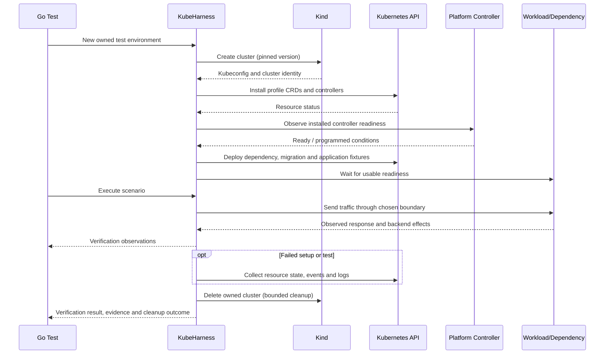

### Explicit deployment and network boundary

A test must declare **where traffic originates**. A host-side request through a port forward is not the same as a Pod-to-Pod request subject to Istio policies, and a direct Service call is not the same as calling through Gateway API. A traffic driver must label its origin and endpoint to avoid false confidence.

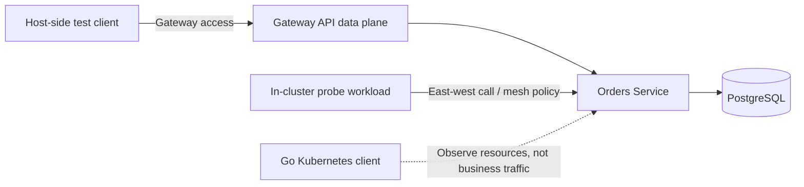

## 6. Lifecycle state machines and invariants

### 6.1 Owned environment lifecycle — candidate states

State names and transitions are **conceptual**. Use them to derive failure and cleanup tests before choosing implementation types.

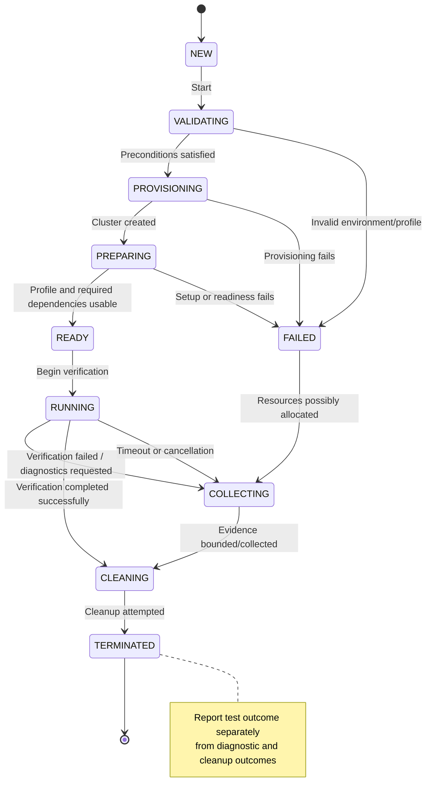

**Interpretation:** `FAILED` describes the primary setup or execution failure, not the last resource lifecycle action. If any resource was allocated, cleanup is still required. The report may show `verification=failed`, `diagnostics=partial` and `cleanup=failed` simultaneously; one outcome must not erase the others. Some preflight failures may have no resources to clean.

### 6.2 Dependency readiness lifecycle

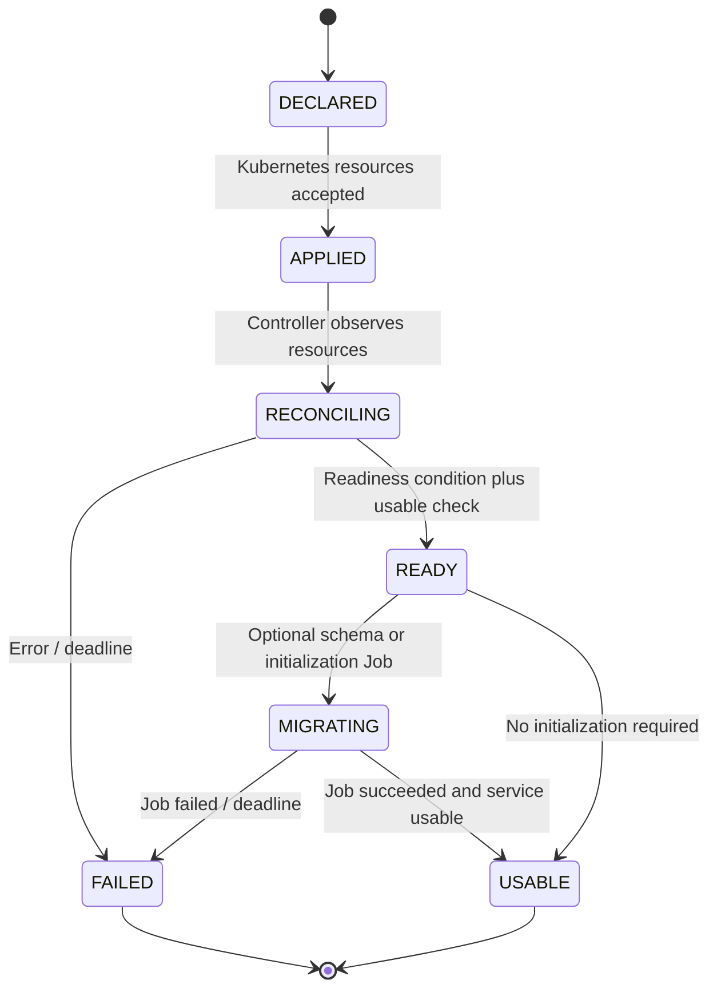

A Pod being `Running`, a Deployment being `Available`, a Gateway being `Programmed`, and a PostgreSQL server accepting connections represent **different conditions**. Tests must observe the condition needed for the next operation.

### 6.3 Critical invariants and failure paths

- **Ownership:** every destructive operation targets a resource tracked as created/owned by this harness instance; no preexisting cluster targets in v1.x.
- **Setup order:** prerequisites before CRDs, CRDs before custom resources, controller readiness before relying on reconciliation, database readiness before migrations, migrations before application verification.
- **Partial allocation:** a failed cluster create, controller install, kubeconfig initialization, image load or port mapping cannot silently abandon previously allocated resources.
- **Idempotence:** repeated cleanup calls must be safe, within a bounded deadline, and must preserve any cleanup errors.
- **Cancellation:** caller cancellation ends verification but still triggers best-effort cleanup under an independently bounded cleanup context.
- **Evidence ordering:** collect relevant diagnostics before removing resources, subject to a maximum evidence/cleanup time budget.
- **Result integrity:** record primary cause, secondary diagnostics failure, and cleanup failure independently; preserve partial observations.
- **Port allocation:** do not rely on “get free port, release it, assume it stays free” as an exclusive reservation. The access strategy must handle races and retries.
- **Isolation:** shared cluster resources (GatewayClass, CRDs, mesh-wide policies) require explicit suite ownership and collision protection; namespaces alone do not isolate them.
- **No indefinite waits:** controller, Job, network and teardown loops are context-bound and use watch/poll with recorded last observed conditions.

## 7. Platform profiles and compatibility

A **profile** is a test environment recipe, not an independently managed cluster and not a claim that every provider supports the same feature set.

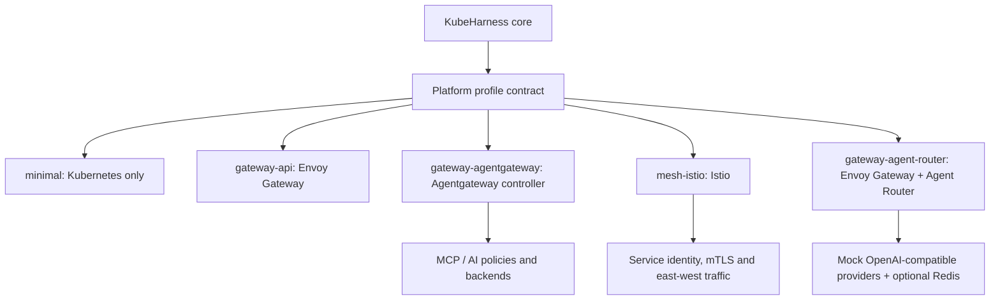

| Priority | Profile | Installs / controls | Intended common contract | Extension-specific work |
| --- | --- | --- | --- | --- |
| P0 | `minimal` | Kubernetes + application/dependency fixtures | Creation, deployment, jobs, readiness, cleanup | DB/Redis setup supplied by fixtures |
| P0 | `gateway-api` | Gateway API CRDs + **Envoy Gateway** | `GatewayClass`, `Gateway`, `HTTPRoute`, `ReferenceGrant`, conditions, external HTTP behavior | Envoy installation/config only |
| P1 | `gateway-agentgateway` | Agentgateway Kubernetes controller/proxy | Supported Gateway API behavior and request transport | `AgentgatewayBackend` / `AgentgatewayPolicy`, MCP auth/federation |
| P2 | `mesh-istio` | Istio service mesh, initially sidecar mode | In-cluster calls, identity and service reachability | `PeerAuthentication`, `AuthorizationPolicy`, traffic policies |
| P2 | `gateway-agent-router` | Envoy Gateway **plus** Agent Router | Gateway traffic + application behavior | `AIGatewayRoute`, `AIServiceBackend`, provider routing/quotas |

### Profile contract candidates

A profile must specify a **pinned compatible matrix** of Kubernetes/node image, Gateway API CRDs, controller/chart/app version and fixture images. It must expose:

1. **Preflight:** runtime availability, resources and compatibility; no writes to an existing user cluster.
2. **Install:** create CRDs/controllers and required namespace-scoped services, with tracked ownership.
3. **Observe:** declare controller-specific readiness/status probes and a usable endpoint resolution strategy.
4. **Configure:** apply portable Gateway API resources and versioned extension CRDs only when supported.
5. **Diagnose:** identify relevant Pods, CRDs, policies, Services and logs to collect on failure.
6. **Dispose:** hand every allocated resource to cluster teardown, with an optional orderly stop sequence where useful.

For v1, the simplest implementation may be **statically registered profiles** rather than a generic plugin registry. Do not prematurely freeze a YAML profile schema or provider interface. Evaluate typed Go fixtures, declarative recipes, and hybrid approaches during planning.

### Version requirements to verify at implementation time

As of this document's review, Agent Router documents a minimum **Kubernetes 1.32** and **Envoy Gateway 1.9.2** for its Kubernetes deployment. Agentgateway v1.0 ships its own Kubernetes controller, separate from kgateway, and depends on Gateway API 1.5.0 (D26). **Do not inherit kubecheck's pinned Kubernetes 1.30.10**. Recheck all version minimums when each profile is implemented and pin an exact tested combination; documentation versions can change.

### Kubernetes services and data dependencies

Database and cache dependencies should be first-class **workload fixtures**, not database implementations inside the harness. A common flow is:

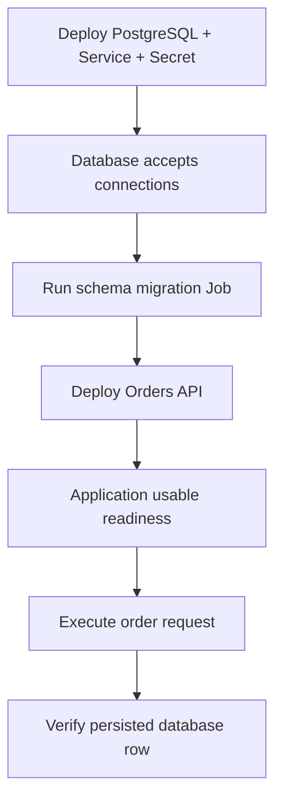

Initially prefer in-cluster dependencies for Kubernetes integration behavior. Testcontainers could be a complementary option later, but introducing an external-container dependency model is not required for the first slice. For throughput, consider suite-level cluster reuse only with proven data and policy isolation; cluster-per-scenario is safer but more expensive.

## 8. Verification experiment catalog

Each experiment below is a **candidate**. It becomes an implementation commitment only after pstack derives the exact fixture contract, environment compatibility, oracle, baseline, and evidence required. IDs are stable planning handles.

### P0 — `minimal`

| ID | Candidate experiment | Intended value / hypothesis | Observed oracle | Failure injection / evidence |
| --- | --- | --- | --- | --- |
| **M01** | Orders API + PostgreSQL + migration Job | Multi-component Kubernetes integration can be reproducible without shared infra | Request yields 201; expected row persisted; migration complete; all owned resources disposed | Break migration; collect Job status/logs, Pod events, app logs, cleanup result |
| **M02** | Dependency readiness and failure classification | Harness does not mistake a running Pod for a usable dependency | Test never enters business verification while DB connection/migration is unhealthy; root cause classified | Unreachable DB or failed schema Job; inspect readiness history and error category |
| **M03** | Isolation and lifecycle failure | Concurrent or consecutive tests cannot leak/contaminate one another | Unique names/data; deliberate assertion failure/cancellation leaves no owned cluster after bounded cleanup | Force failure at selected setup phases; compare Docker/Kind resource inventory before/after |

**Flagship:** M01; **non-negotiable lifecycle gate:** M03. Reuse a simple Orders service with a stable HTTP contract and deterministic data. Avoid production databases or live remote dependencies.

### P0 — `gateway-api` (Envoy Gateway default)

| ID | Candidate experiment | Intended value / hypothesis | Observed oracle | Failure injection / evidence |
| --- | --- | --- | --- | --- |
| **G01** | Orders/Payments HTTP routing through Envoy Gateway | End-to-end platform route works, not just Deployment readiness | Correct response and backend identity for distinct hosts/paths | Wrong target port/hostname; Gateway/HTTPRoute status, Envoy logs, backend request count |
| **G02** | Cross-namespace `ReferenceGrant` | Controller enforces cross-namespace reference permission | Without grant: unresolved reference and traffic cannot reach backend; after grant: status and traffic succeed | Remove/reapply grant; record `ResolvedRefs` where available and actual data plane result |
| **G03** | Live HTTPRoute reconfiguration | Status and data-plane routing converge after updates | With 100/0 then 0/100 weights, requests consistently reach selected backend after readiness | Update route during traffic; capture transition time and backend IDs |

**Flagship:** G02, because it exercises reconciliation, network authorization and traffic. Do not assert that an invalid backend produces exactly HTTP 403: controller and proxy failure responses vary. Observe conditions and failed forwarding to the protected backend instead. Start G03 with deterministic 100/0 changes rather than noisy statistical traffic splits.

### P1 — `gateway-agentgateway`

| ID | Candidate experiment | Intended value / hypothesis | Observed oracle | Failure injection / evidence |
| --- | --- | --- | --- | --- |
| **A01** | MCP discovery/invocation behind Gateway API | MCP over Kubernetes routing reaches a real tool backend | `tools/list` includes `sum`; `tools/call sum(40,2)` yields 42 | Break Service path/appProtocol; collect route/backend status and MCP connection errors |
| **A02** | Identity-based MCP tool authorization | Gateway policies enforce both discovery filtering and direct call authorization | Reader sees/calls `read_order` but not `delete_order`; admin can use both; unauthorized direct invocation denied | Swap JWT claims/expiry; capture tool lists, policy status, backend invocation counter |
| **A03** | Federated MCP tools | Multiple MCP Services can present one usable endpoint without name collisions | Tool discovery includes distinct tools; calls reach correct backend with expected results | Break one backend; observe policy/route and protocol behavior, including failure semantics |

**Flagship:** A02. Inspired by Agentgateway's [MCP authorization example](https://github.com/agentgateway/agentgateway/blob/main/examples/mcp-authorization/README.md) (JWT claims plus CEL policy) and [MCP multiplex example](https://github.com/agentgateway/agentgateway/blob/main/examples/mcp-multiplex/README.md). **Caution:** These example directories use standalone configuration in places. Implement Kubernetes tests using the pinned controller's documented Gateway API / `AgentgatewayPolicy` / `AgentgatewayBackend` features; independently verify that each proposed policy and federation feature exists in that Kubernetes release. Do not assume 1:1 config portability.

Suggested topology:

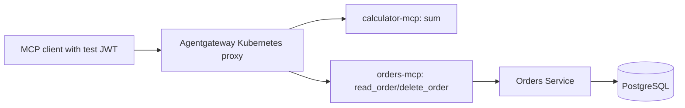

### P2 — `mesh-istio`

| ID | Candidate experiment | Intended value / hypothesis | Observed oracle | Failure injection / evidence |
| --- | --- | --- | --- | --- |
| **I01** | Workload identity authorization | Real east-west access follows declared ServiceAccount principals | Orders allowed to call Payments; unapproved workload denied and no backend invocation | Modify `AuthorizationPolicy`; collect principal, policy, proxy and service logs |
| **I02** | Strict mTLS | TLS enforcement is observed at the network boundary, not assumed from YAML | Meshed caller succeeds; unmeshed plaintext caller cannot reach protected workload | Change `PeerAuthentication` and caller identity; capture proxy connection evidence |
| **I03** | Service traffic shifting | Runtime mesh policy changes determine backend version | 100% v1 then 100% v2 reaches the expected version after reconciliation | Deliberately misconfigure subset labels; collect route/policy and destination counters |

**Flagship:** I01. Start with sidecar mode. Ambient-mode behavior should be separately assessed because waypoint routing and L7 enforcement change the request path. An in-cluster probe is necessary; a host port-forward bypasses key service-mesh policy enforcement paths.

### P2 — `gateway-agent-router` (Envoy Gateway + Agent Router)

| ID | Candidate experiment | Intended value / hypothesis | Observed oracle | Failure injection / evidence |
| --- | --- | --- | --- | --- |
| **R01** | Model routing to local mock providers | AI-specific routing selects the intended backend | Header/model selection maps to correct mock backend; valid OpenAI-compatible response | Wrong model mapping; collect `AIGatewayRoute`, backend status, proxy logs, invocation counters |
| **R02** | Provider fallback on controlled failure | Real proxy retry/fallback configuration works with no paid AI account | With fallback disabled primary failure propagates; when enabled secondary returns 200 and is called | Primary fails with configured retryable status/connection error; collect attempt counts and route policy |
| **R03** | Tenant-aware token quota backed by Redis | Per-tenant token usage is accounted and isolated in a multi-component stack | Tenant A crosses allowance and subsequent request gets 429; tenant B remains allowed | Simulate deterministic completion usage; inspect rate-limit service, Redis and response metadata |

**Flagship:** R02. Inspired by [Agent Router provider fallback](https://github.com/theagentrouter/agent-router/tree/main/examples/provider_fallback), including an `AIGatewayRoute` with prioritized backends and an Envoy Gateway `BackendTrafficPolicy`. The upstream E2E test uses AWS credentials for the healthy fallback. Adapt this to **two local OpenAI-compatible mock backends**, with one deliberately failing; no cloud secret or network required.

R03 is inspired by [token rate limiting](https://github.com/theagentrouter/agent-router/tree/main/examples/token_ratelimit) and the [upstream Go E2E test](https://github.com/theagentrouter/agent-router/blob/main/tests/e2e/token_ratelimit_test.go), which drives synthetic token usage and a Redis-backed rate-limiting service. Respect **post-response usage accounting**: a request that *causes* an allowance to be exceeded may be admitted, while a later request is rejected. Use stable tenant IDs and ensure accounting has settled before asserting the next request.

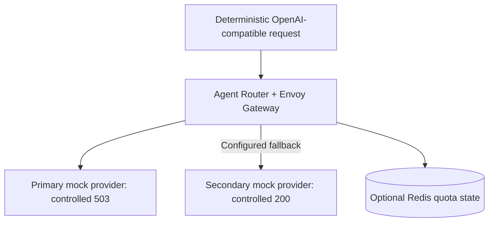

### Experiment prioritization and dependency map

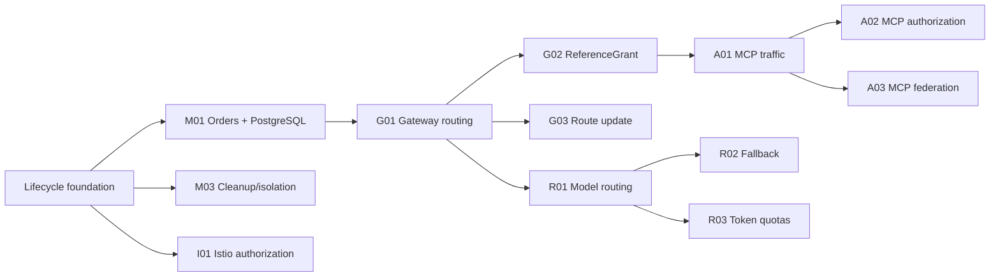

The graph shows **suggested prerequisite knowledge**, not necessarily hard implementation dependencies. In particular, `mesh-istio` can develop independently of the gateway profiles once the lifecycle layer is mature.

## 9. Verification methodology: prove the harness, not only the gateway

An experiment that passes proves that an upstream component behaved correctly **in that test environment**. It does *not automatically* prove KubeHarness adds value over Kind + Helm + kubectl + plain Go tests.

### Measurement dimensions

| Dimension | Observable measure | Baseline / comparison |
| --- | --- | --- |
| Reproducibility | Successful, failed and flaky runs with pinned dependencies | Repeated clean Kind runs (initial **20-run screening heuristic**, not statistical assurance) |
| Lifecycle correctness | Leak count, cleanup errors, cancellation behavior, orphaned containers/ports | Manual Kind teardown plus targeted fault injection |
| Diagnostic usefulness | Whether captured evidence identifies the known root cause | Baseline CI logs/kubectl manual triage |
| Developer effort | Lines/steps of test setup, maintenance, manual commands and cognitive burden | Plain Kind/Helm/kubectl/Go implementation of same scenario |
| Runtime cost | Cold/warm setup and execution times, CPU/memory, images pulled | Equivalent baseline topology without harness wrapper |
| Behavioral fidelity | Correct positive/negative assertions, backend invocation counts, control/data plane agreement | Predefined oracle unaffected by implementation |

### Recommended experiment protocol

1. **Freeze** test scenario, versions/images, fixtures, inputs and observable oracles before running the framework implementation.
2. Build a **baseline** for the same scenario using existing tools. Do not compare a richer KubeHarness test to a simpler baseline.
3. Run the test on fresh ephemeral infrastructure; record setup, verification, evidence and teardown separately.
4. Inject known failures (bad secret, failed migration, invalid `ReferenceGrant`, rejected JWT, primary LLM 503, cancellation) and inspect whether evidence supports the correct diagnosis.
5. Check Docker/Kind resources after the run; report leaks and uncertain disposal explicitly.
6. Repeat on pinned versions and compute observations; label run variance rather than asserting reliability from a small sample.
7. Decide **accept / revise / defer** based on evidence and whether the extra abstraction demonstrably reduces developer work or improves diagnostics.

**Do not invent fixed speed or pass-rate thresholds yet.** Establish a baseline first, then choose a meaningful decision gate. Nevertheless, a leaked test-owned cluster or concealed cleanup error is a correctness defect even if the business assertion passes.

### Result and evidence model — conceptual

A case result should distinguish:

- **Environment outcome:** preflight, provisioning, profile setup and usable readiness.
- **Verification outcome:** which expected behavior was observed, assertion status and concrete probe origin.
- **Evidence outcome:** captured, partial, failed, redacted and artifact locations.
- **Cleanup outcome:** attempted, succeeded, partially succeeded, or failed, with resource inventory.
- **Termination cause:** success, validation error, provisioning error, scenario failure, deadline, explicit cancellation, unexpected panic.

No single aggregate `PASS` should hide secondary operational failures. Possible future structured artifact fields: run ID, profile/version matrix, cluster ID, scenario ID, timestamps, terminal reason, observed Kubernetes conditions, redacted request and response samples, backend invocation counters, event/log attachment pointers, and cleanup inventory.

## 10. Delivery roadmap and proposed slices

The **priority** of a profile is distinct from exact version numbering; do not equate P1 with semantic version 1.0 or P2 with version 2.0. **v2.0.0 is reserved as the earliest investigation boundary for existing-cluster support.**

| Suggested slice | Visible product outcome | Acceptance / proof | Status |
| --- | --- | --- | --- |
| S0 — Foundation | Small Go module, local test runner and testability seams | Fast unit tests, Docker prereq detection, documented pinned toolchain | Done (#1, #2) |
| S1 — Owned lifecycle | Create and dispose of a Kind cluster safely | Partial failures, cancellation, double cleanup, deadline and leak tests | Done (#1) |
| S2 — M01 vertical slice | Orders + PostgreSQL + migrations | One reproducible end-to-end test; negative migration scenario; diagnostics | Done (#3, #4), accepted |
| S3 — Gateway API | Envoy Gateway standard profile | G01/G02/G03, resource status and data-plane evidence | In progress (G01 and G02 landed; G03 next) |
| S4 — Agentgateway | Kubernetes-native MCP profiles | A01/A02/A03 with deterministic tool servers and identities | Proposed |
| S5 — Istio | East-west networking profile | I01/I02/I03 with explicit traffic-origin checks | Proposed |
| S6 — Agent Router | Envoy AI routing profile | R01/R02/R03 with local mock providers and Redis | Proposed |
| Future v2.0.0 investigation | Existing staging cluster design | Ownership, RBAC, read-only/mutation policies, cleanup safety, data isolation and explicit opt-in | Deferred |

### S1 lifecycle acceptance examples

- If Kind creates a container and a later kubeconfig/client initialization step fails, cleanup still attempts to delete the cluster.
- If a profile installation times out, the original timeout and relevant last-seen controller conditions remain visible after cleanup.
- If cleanup fails, the harness reports the primary failure and the cleanup failure distinctly.
- Calling cleanup twice does not delete any external/unowned resource or create a new error through double disposal.
- A cancellation during readiness does not leave an infinite watch or bypass cleanup.
- No test relies on a guarantee that two independent free-port probes return different port numbers.

### S2 (M01) acceptance examples

- A new contributor can run the reference scenario locally with the documented prerequisites and **no cloud account**.
- A successful test verifies real PostgreSQL persistence, not merely a mocked repository return value.
- A failed migration blocks business assertions and yields actionable Job status/logs.
- Test success, diagnostics status and teardown are recorded separately.
- A baseline implementation is retained for effort/performance comparison.

### S2 result: accept

Measured with `examples/orders/setuplines` and `examples/orders/compare.sh`, on Docker Desktop with kind v0.33.0 and Kubernetes v1.37.0:

| | kubeharness | plain kind + kubectl + Go |
| --- | --- | --- |
| Setup code lines | 8 | 70 |
| Wall time, median of 5 alternating runs | 38.5s (37.0 to 39.5s) | 40.0s (38.5 to 40.6s) |

The time difference is within run-to-run variation; cluster creation takes about 25s of each run. Both setups stop on a failed migration with the Job's logs. The harness cuts setup code by about nine tenths at no measurable time cost, so S2 is accepted. Its open item is the per-test cluster cost, which S3 will multiply by installing Envoy Gateway in every cluster (question 2).

One acceptance example is partly met: setup, test, and cleanup outcomes are separate fields of the report line, but there is no diagnostics field. Evidence is carried in failure messages instead.

### S3 slice plan

The design was chosen from two independent candidates and approved before code. A test calls `h.InstallGateway(kubeharness.EnvoyGateway())` on an unchanged `New(t)`, gets a typed controller, and sends traffic with `gc.Gateway("edge").Client()`. The proxy Service is ClusterIP; the harness reads the address from Gateway status, finds the Service with that cluster IP, and port-forwards to a ready proxy Pod (D25). Profiles are data recipes with manifests rendered offline and embedded (D24). Each slice is one PR ending in a CI check.

| Slice | Scope | Ends when |
| --- | --- | --- |
| 0 | G01 with plain kind + Helm + kubectl + Go, no library code | Passes in CI and on Docker Desktop with per-step timings |
| 1 | `InstallGateway` with the embedded Envoy Gateway recipe and `hack/render` (Helm SDK in its own module) | Invariant unit tests; GatewayClass Accepted in e2e; a bad-image fault fails inside the install timeout with evidence |
| 2 | The `Gateway` handle and G01 through the harness | G01 and a wrong-port negative pass; compared with slice 0 (accept/revise) |
| 3 | `"ns/name"` references, `h.Delete`, and G02 with grant and revoke | 20-run screen with no leaks |
| 4 | G03 under live traffic | 20-run screen; convergence time and the S3 result recorded |
| 5 | Preload profile images, only if the numbers call for it | Cold vs cached comparison |
| 6 | S4 entry: the agentgateway recipe | G01 to G03 pass under both profiles with no test changes |

### S3 slice 0 result

`examples/gateway` runs G01 the plain way. Envoy Gateway v1.9.3 with Gateway API v1.6.1 standard CRDs works on kind v0.33.0's default Kubernetes v1.37.0, outside Envoy Gateway's published 1.33 to 1.36 range; that is the tested combination until it fails. With a ClusterIP proxy Service, the Gateway's status address was the cluster IP of exactly one Service on every run, and a loopback port-forward to it carried the G01 traffic. With the default LoadBalancer type the Gateway stayed `Programmed=False` with reason `AddressNotAssigned`.

Seconds per step, four runs on Docker Desktop (linux/arm64, 12 CPUs):

| create | Gateway API and EG CRDs | controller ready | class accepted | backends ready | Programmed | first response | total |
| --- | --- | --- | --- | --- | --- | --- | --- |
| 24.6 to 26.5 | 5.2 to 5.4 | 10.6 to 11.3 | 0.3 | 1.1 to 1.4 | 10.7 to 11.6 | 0.2 | 53.1 to 55.8 |

Kubelet pulled `envoyproxy/gateway:v1.9.3` in 5.0 to 5.9s and the Envoy proxy image in 4.1 to 4.5s on every run. Installing the profile and reaching Programmed adds about 28s to the 25s cluster creation. Image pulls are about 10s of that, and the CRD step includes network fetches that embedded manifests remove. Neither pulls nor controller startup dominate, so S3 keeps one cluster per test and slice 5 stays gated on the slice 2 numbers.

### S3 slice 1 result

`h.InstallGateway(kubeharness.EnvoyGateway())` installs the embedded recipe (D28, D29). On Docker Desktop (linux/arm64, 12 CPUs) the report line's `install=` was 15.7s, 15.7s, and 15.1s in three runs, against 16.1 to 17.0s for the same steps in slice 0 (CRDs, controller ready, class accepted), which fetched the Gateway API CRDs over the network and ran Helm. Embedding saves about a second; image pulls and controller startup remain most of the install. A controller image digest that does not exist fails the install at the operation deadline with the controller Pod's pull errors, and the cluster is still removed.

### S3 slice 2 result: accept

`GatewayController.Gateway(ref)` resolves the Gateway status `IPAddress` to exactly one ClusterIP Service and opens one loopback port-forward per listener port (D31). `Client`, `AwaitRoute`, and `AwaitResponse` send real HTTP through that path. G01 and the closed-`targetPort` negative pass in CI and on Docker Desktop. A live HTTPRoute `shop` for Gateway `edge` had one matching parent for the Envoy Gateway controller, so `StatusFor`'s duplicate-parent Stop is safe for G01.

Measured with `examples/gateway/setuplines` and `examples/gateway/compare.sh`, on Docker Desktop with kind v0.33.0 and Kubernetes v1.37.0 (linux/arm64, 12 CPUs). Load averages at the start of the compare were about 3.8 to 5.1. The script alternates harness and baseline so both sides see the same noise. Every run passed (`failures=0`).

| | kubeharness | plain kind + Helm + kubectl + Go |
| --- | --- | --- |
| Setup code lines | 12 | 141 |
| Wall time, median of 5 alternating runs | 52.2s (51.5 to 55.0s) | 54.2s (52.5 to 54.7s) |

The time gap is inside the run-to-run ranges. Totals match the slice 0 end-to-end window (~53 to 56s). Cluster create, profile install, and Programmed still dominate the wall clock. The harness cuts setup code by about nine tenths at no measurable time cost, so the slice 2 handle is accepted and G02 can build on it.

Cost rule after these numbers: image pulls and controller startup still do not dominate over create. S3 keeps one cluster per test. Slice 5 (image preload) stays gated until a later screen shows pulls as the limiter.

### S3 slice 3 result: accept

`WaitReady` and `Forward` take `"namespace/name"`. `Harness.Delete(dir)` removes manifests in reverse Apply order until each GET is `NotFound` (D32). `examples/gateway` `TestG02ReferenceGrant` proves deny → grant Apply → allow → grant Delete → deny through `AwaitRoute`, `AwaitResponse`, and a payments request counter read over `Forward("payments/payments", 80)`. `TestG02DeniedRouteExplainsItself` expects `RouteReady` to fail with `route shop/pay` and `RefNotPermitted` in the existing evidence text.

One Kind drive on Docker Desktop (linux/arm64) passed both tests (`TestG02ReferenceGrant` 57.4s, `TestG02DeniedRouteExplainsItself` 113.2s) with `cleanup=succeeded remaining=0` and `kubeharness leaks: 0` after the drive. A 20-run screen of `TestG02ReferenceGrant` alone passed every run (`pass=20 fail=0 leaked_runs=0`). The slice is accepted. G03 is next.

## 11. Design risks, trade-offs and mitigations

| Risk | Why it matters | Mitigation / investigation |
| --- | --- | --- |
| Slow Kind + controller startup | Makes `go test` unattractive | Profile-scoped suites, cache pinned images, measure cold/warm; prefer correctness initially |
| Docker/network/port races | Unreliable CI environments | Preflight, owned forwarding/mapping with cleanup, structured retry with deadlines |
| CRD/controller version mismatch | Install succeeds partially or status differs | Compatibility matrix; pin tested chart and CRD versions; fail fast |
| Control-plane success but data-plane failure | Misleading “ready” state | Verify both resource conditions and real network traffic |
| Evidence collection blocks teardown | Leaks infra on failed tests | Separate bounded evidence and cleanup budgets |
| Shared cluster/policy state | Cross-test interference | Cluster per suite or scenario; explicit isolation for cluster-scoped resources |
| Agentgateway standalone vs Kubernetes config mismatch | Unsupported feature assumptions | Translate examples only using documented Kubernetes CRDs; verify every scenario |
| Agent Router cloud-dependent examples | CI depends on secrets, costs, outages | Local deterministic OpenAI mocks for routing/fallback/quota experiments |
| Service mesh modes differ | Misleading policy verification | Start with sidecar, originate probes in mesh, later consider ambient |
| Overengineering extensibility | More framework code than saved work | Validate M01 and G02 first; start with static profiles rather than plugin SDK |
| Too many assertions hidden in helpers | Difficult test diagnosis | Keep explicit error contexts and domain assertions in developer code |
| Sensitive artifacts | Tokens, payloads, kubeconfig or secrets exposed | Redaction, opt-in capture and artifact retention strategy |
| Changing upstream releases | Examples drift | Pin tested versions and track links/commit SHAs as implementation begins |

## 12. Open questions for pstack planning

These are deliberately **not** resolved by this concept. Prefer narrow decisions tied to the next executable slice. Questions answered by S1 and S2 point to their decision record (D15 to D22); the rest stay open.

1. **Public Go lifecycle API:** Should `New(t)` register cleanup immediately, return a resource handle with explicit `Close`, or both? How are errors surfaced without hiding `testing.T` failures? *Answered (D16):* `New(t)` registers cleanup immediately and has no explicit `Close`; setup failures call `t.Fatalf`, cleanup failures call `t.Errorf`.
2. **Execution ownership:** Is one cluster created per test, per package, or per suite? What is the default and what is opt-in? *Partly answered (D16):* one cluster per test is the default. A package-level cluster is open and is the main cost question for S3.
3. **Contexts:** How are run, setup, per-operation, evidence and cleanup deadlines separated? How do late watchers or tasks terminate? *Answered (D18):* setup and operations share a deadline of `-timeout` minus cleanup and margin, evidence gets its own 10s, cleanup its own budget, and calls that ignore contexts are abandoned and reported.
4. **Installation:** Use Kubernetes `client-go`, Helm SDK, external commands, or an intentionally small hybrid? What are the consequences for CI? *Answered for S1 and S2 (D15, D20):* kind's Go library plus client-go. Helm is untested until a profile needs it. S3 is the first profile that needs it; Envoy Gateway and agentgateway both publish OCI Helm charts, so the S3 choice must install either. *Answered for S3 (D29):* charts are rendered offline with the Helm v4 Go SDK in `hack/render`, a separate module, and the layers are embedded and applied with client-go server-side apply. The library has no Helm dependency, and CI's render job fails when the committed layers drift from their pins.
5. **Manifests and resource inventory:** How does KubeHarness track ownership and rollback after partially successful apply? *Answered (D16):* the inventory is the owned cluster; nothing inside it is tracked, because the cluster is deleted.
6. **Endpoint resolution:** Port forwarding, Kind port mappings, in-cluster probe, or combinations based on traffic origin? How are port races handled? *Answered for host traffic (D20):* client-go port-forward on loopback, holding its listener. In-cluster probes remain open for S5.
7. **Readiness abstraction:** Which stock observations are necessary for S1/S2, and how are application-defined usability checks expressed? *Answered for S2:* `WaitReady` follows `kubectl rollout status`; application usability is the Deployment's readinessProbe.
8. **Diagnostics:** What is mandatory vs optional on failure, and which formats/size limits/redaction rules apply?
9. **Version compatibility:** Which tested Kubernetes/Kind/Envoy versions should be the first release matrix? What is the upgrade policy? *Answered for S1 and S2:* kind v0.33.0 with its default Kubernetes v1.37.0 node image, client-go v0.37.2, Go 1.27.3. *For S3 (D30):* the same node image with Gateway API v1.6.1 standard and Envoy Gateway v1.9.3, outside Envoy Gateway's published Kubernetes range and kept while it passes.
10. **Profile representation:** Start with hardcoded typed Go implementations or declarative recipes? How to avoid a premature general plugin system? *Answered for S3 (D28):* declarative recipes. Inside the library a profile is a `profile.Recipe` value of pins, embedded manifest layers, a GatewayClass `controllerName`, and controller Deployments, with no interface and no function fields; one `profile.Install` runs every recipe. The public API is an opaque `GatewayProfile` from constructors such as `EnvoyGateway()`. There is no registry or plugin interface.
11. **Experiment oracle ownership:** What should the harness assert versus what should remain plain Go test code?
12. **Fixture selection:** How much of Orders/PostgreSQL, HTTP mock LLM, and MCP test server belongs in example repository assets versus the shipped library? *Answered (D22):* fixtures live in example modules, not the library.
13. **Result publication:** Are Go test output and CI artifacts enough for v1, or is a structured machine-readable result necessary early? *Answered for v1 so far:* Go test output with one report line per cluster is enough; no structured artifact yet.
14. **v2 existing-cluster safety:** Do not design yet; record a future investigation of opt-in capability, restricted RBAC, ownership and protected cleanup.

## 13. pstack planning protocol

Use this document to supply **context and stable constraints**, not to instruct pstack to implement everything at once. Each slice should have a small artifact bundle and a clear review gate.

### Suggested planning flow

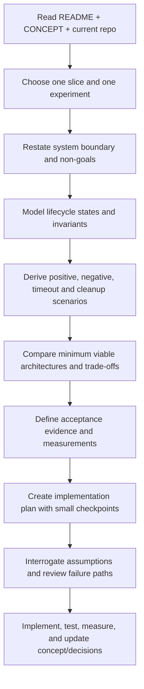

### Required planning artifacts per slice

1. **Boundary:** user value, actors, observable outputs, dependencies, explicitly excluded work.
2. **Behavioral model:** resource states, events, transitions, failure paths, invariants and ownership.
3. **Contract:** proposed Go API surface *only for the selected slice*; error and cancellation semantics.
4. **Scenarios:** happy path, known failures, retries, cancellation, diagnostics and double/partial cleanup.
5. **Architecture trade-offs:** at least two plausible implementation approaches where there is a real choice, with consequences and risks.
6. **Verification plan:** reproducible test fixtures, baseline, negative controls, metrics and acceptance criteria.
7. **Delivery steps:** small PR-sized tasks with dependencies and explicit completion checks.
8. **Decision log:** accepted decisions, discarded alternatives, unresolved questions and docs to update.

### How to use multi-agent review

Use multiple agents for **independent perspectives**, not duplicate implementation. Useful responsibilities: an architect for boundaries and design alternatives, a failure-mode investigator for lifecycle/cancellation/isolation, a test designer for experiment oracles and negative controls, and an independent reviewer to challenge assumptions. Assign implementation only after these reviews reconcile on contracts and slice scope. For pstack's configured model/role allocation, let the tool's actual setup determine routing; this document does not prescribe specific model IDs.

### Starter pstack request

> Read README.md and CONCEPT.md in ogarciacar/kubeharness. Plan **only S1: Owned cluster lifecycle**. Do not implement gateways or existing-cluster support. Produce the system boundary, a behavior state machine, invariants, an explicit public Go API proposal with alternatives, failure and teardown matrix, isolation/cancellation strategy, and an incremental implementation plan with executable acceptance tests. Challenge the plan for leaked clusters, port races, premature extensibility and errors masked by cleanup. Treat README/CONCEPT as concept, not as proof of existing implementation.

For S2, replace the scope with **M01: Orders + PostgreSQL + migrations** and require a baseline comparison using plain Kind/Go tests.

## 14. Sources and inspiration

The following links are **upstream inspirations**, not code copied into KubeHarness. Verify current APIs, licenses and supported versions when turning any example into source code; freeze a specific upstream revision in the relevant implementation PR.

### Foundations

- [Kind](https://kind.sigs.k8s.io/)
- [Kubernetes Gateway API](https://gateway-api.sigs.k8s.io/)
- [Envoy Gateway traffic management](https://gateway.envoyproxy.io/latest/tasks/traffic/)
- [Envoy Gateway HTTPRoute traffic splitting](https://gateway.envoyproxy.io/latest/tasks/traffic/http-traffic-splitting/)
- [Istio authorization](https://istio.io/latest/docs/tasks/security/authorization/authz-http/)
- [Istio mTLS security](https://istio.io/latest/docs/concepts/security/)

### Agentgateway

- [Project repository](https://github.com/agentgateway/agentgateway)
- [Kubernetes controller and Gateway API concepts](https://agentgateway.dev/docs/kubernetes/latest/documentation/about/overview/)
- [Kubernetes quickstart](https://agentgateway.dev/docs/kubernetes/latest/documentation/quickstart/install/)
- [MCP authorization example](https://github.com/agentgateway/agentgateway/blob/main/examples/mcp-authorization/README.md)
- [MCP multiplex example](https://github.com/agentgateway/agentgateway/blob/main/examples/mcp-multiplex/README.md)
- [OpenAPI-to-MCP example](https://github.com/agentgateway/agentgateway/blob/main/examples/mcp-openapi/README.md)
- [Per-key rate limiting example](https://github.com/agentgateway/agentgateway/blob/main/examples/llm-keyed-rate-limit/README.md)
- [Fault injection example](https://github.com/agentgateway/agentgateway/blob/main/examples/fault-injection/README.md)
- [agentgateway v1.0.0 announcement](https://agentgateway.dev/blog/2026-03-12-agentgateway-v1.0/): controller moves out of kgateway; images and charts under `cr.agentgateway.dev`
- [Agentgateway 2.2.x release notes](https://agentgateway.dev/docs/kubernetes/2.2.x/reference/release-notes/): last release on the kgateway control plane; `controllerName` change

### kgateway (considered, not adopted; D23)

- [kgateway](https://kgateway.dev/)
- [kgateway repository](https://github.com/kgateway-dev/kgateway): README notes the agentgateway control plane migration in 2.3.0

### Agent Router (formerly Envoy AI Gateway)

- [Project repository](https://github.com/theagentrouter/agent-router)
- [Getting started](https://theagentrouter.ai/docs/getting-started/)
- [Kubernetes prerequisites](https://theagentrouter.ai/docs/getting-started/prerequisites/)
- [Examples index](https://github.com/theagentrouter/agent-router/blob/main/examples/README.md)
- [Basic Gateway API and AI route manifests](https://github.com/theagentrouter/agent-router/blob/main/examples/basic/basic.yaml)
- [Provider fallback example](https://github.com/theagentrouter/agent-router/tree/main/examples/provider_fallback)
- [Provider fallback E2E test](https://github.com/theagentrouter/agent-router/blob/main/tests/e2e/provider_fallback_test.go)
- [Token rate limit example](https://github.com/theagentrouter/agent-router/tree/main/examples/token_ratelimit)
- [Token rate limit E2E test](https://github.com/theagentrouter/agent-router/blob/main/tests/e2e/token_ratelimit_test.go)
- [MCP authorization E2E tests](https://github.com/theagentrouter/agent-router/blob/main/tests/e2e/mcp_route_authorization_test.go)
- [Inference pool example](https://github.com/theagentrouter/agent-router/tree/main/examples/inference-pool)

---

**Concept completion criterion:** A planning agent can select one slice, state what is inside and outside its boundary, trace the relevant state transitions and invariants, design a discriminating experiment with negative controls, and produce a defensible implementation plan **without assuming any of the proposed framework APIs or platform profiles already exist**.