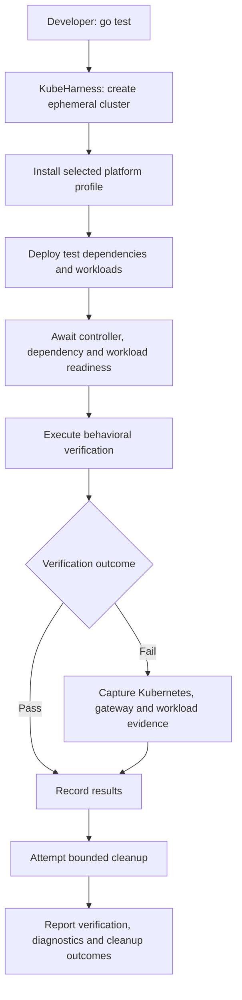
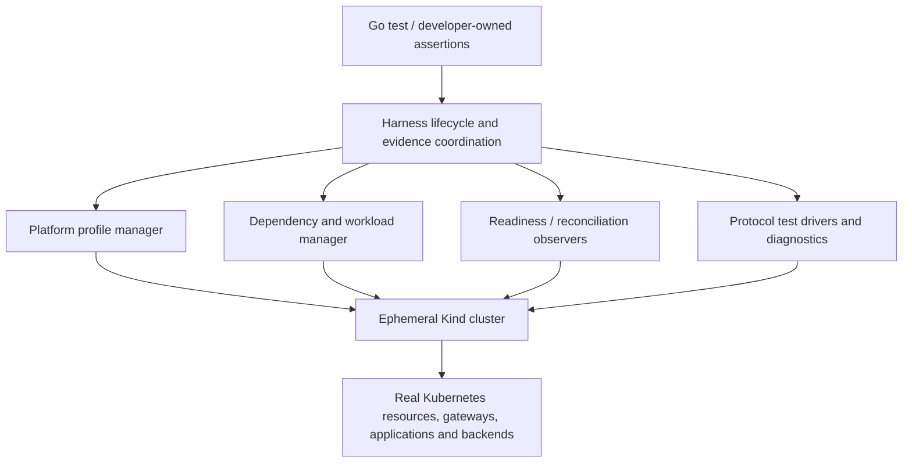

# KubeHarness

**Test real Kubernetes platform behavior with the simplicity of Go tests.**

KubeHarness is a **proposed Go-native platform integration testing harness** for reproducible, isolated Kubernetes environments. It aims to let developers express application and platform expectations while the harness provisions the cluster, deploys dependencies and workloads, waits for usable readiness, executes verifications, gathers failure evidence, and cleans up.

> **Status: S1 and S2 are implemented; S3 Gateway API (Envoy and agentgateway profiles) and S4 A01 (MCP through AgentGateway) are implemented; A02/A03 and later profiles are still concept.** This repository is a clean start, not a rename or fork of [kubecheck](https://github.com/ogarciacar/kubecheck). `kubeharness.New(t)`, the workload methods, `InstallGateway`, and `Gateway.AwaitProbe` exist today. See [CONCEPT.md](CONCEPT.md) for decisions, trade-offs, candidate experiments, and planning inputs.

## Quick start (implemented today)

Requires Go 1.27 and a running Docker daemon. No `kind` binary or cloud account is needed.

```go
package orders_test

import (
    "testing"

    "github.com/ogarciacar/kubeharness"
    metav1 "k8s.io/apimachinery/pkg/apis/meta/v1"
    "k8s.io/client-go/kubernetes"
)

func TestCluster(t *testing.T) {
    h := kubeharness.New(t) // owned Kind cluster, deleted via t.Cleanup
    client := kubernetes.NewForConfigOrDie(h.RESTConfig())
    nodes, err := client.CoreV1().Nodes().List(t.Context(), metav1.ListOptions{})
    if err != nil {
        t.Fatal(err)
    }
    t.Logf("%d nodes", len(nodes.Items))
}
```

Each run logs one report line with setup, test, and cleanup outcomes as separate fields. `go test` shows it with `-v` or when the test fails:

```text
kubeharness cluster=kh-443ca88f073e-10066 phase=ready cause=ok cleanup=succeeded remaining=0 create=7.9s ready=16.8s delete=460ms
```

### Run workloads

`Harness` has six methods for putting workloads on the cluster. Each one fails the test with evidence when it can't finish: the last state it observed, plus the Pods' container states and log tails.

| Method | What it does |
| --- | --- |
| `h.Apply(dir)` | Server-side applies every `.yaml` and `.yml` file in `dir`, in file-name order. Objects without a namespace go to `default`. |
| `h.Delete(dir)` | Removes every manifest in `dir` in the reverse of Apply order and waits until each object is gone. `NotFound` is success. |
| `h.WaitReady(ref)` | Waits until the Deployment named `ref` is rolled out and every replica is available. `ref` is `name` in `default`, or `namespace/name`. |
| `h.RunJob(dir)` | Applies `dir`, which must hold exactly one Job, and waits for that Job to complete. |
| `h.Forward(ref, port)` | Forwards a local port to a Service port and returns the local address, such as `127.0.0.1:53017`. `ref` is `name` in `default`, or `namespace/name`. Use it as a TCP address or prefix `http://`. |
| `h.LoadImage(ref)` | Copies an image you built into the cluster, for manifests that use `imagePullPolicy: Never`. |

Call these methods from the test that created `h`. They fail that test, and a forward stops when that test ends.

```go
h.Apply("testdata/postgres")
h.WaitReady("postgres")
h.RunJob("testdata/migrate")
db, err := sql.Open("pgx", "postgres://app:secret@"+h.Forward("postgres", 5432)+"/orders")
```

The `sql.Open` line needs a driver, for example `import _ "github.com/jackc/pgx/v5/stdlib"`.

`WaitReady` is only as strict as the Deployment's `readinessProbe`. Give PostgreSQL one, such as `exec: {command: [pg_isready, -h, 127.0.0.1]}`. Without it the Deployment counts as available before PostgreSQL accepts connections, and a migration Job started right after can fail.

Set `backoffLimit: 0` and `restartPolicy: Never` on a migration Job. With Kubernetes' default of 6 retries, a failing Job keeps restarting until `RunJob` runs out of time, and you see "did not complete" instead of "failed". With `restartPolicy: OnFailure` the Job controller deletes the failed Pod, and its exit code and logs go with it. Don't set `ttlSecondsAfterFinished: 0` either: the Job is deleted before `RunJob` can see it finish, so `RunJob` fails even when the Job succeeded.

A cleanup that fails or can't be confirmed fails the test and prints a `docker rm` command that removes it. Before setup starts, the cluster name and that command also go to stderr. If you stop `go test` with Ctrl-C, cleanup does not run, and `go test ./...` throws away the test binary's output. Run `hack/leaks.sh` afterwards to list what was left behind.

- `go test ./...` runs the lifecycle fault matrix against a fake provider. No Docker needed.
- `go test -tags e2e ./...` runs against real Kind (kind v0.33.0, Kubernetes v1.37.0).
- `hack/leaks.sh [pattern]` reports leftover `kh-*` clusters, or clusters matching `pattern`. It never deletes.
- `hack/screen.sh [runs]` repeats the e2e suite and tallies pass, fail, and leaks.
- `go -C hack/render run .` re-renders the embedded profile manifests after a pin change in `internal/profile`; `-check` fails when they differ from a fresh render. It needs the network.

### Install a gateway profile

`h.InstallGateway(kubeharness.EnvoyGateway())` or `h.InstallGateway(kubeharness.AgentGateway())` installs the Gateway API CRDs, that controller, and a GatewayClass named `kubeharness`, and returns when that GatewayClass is Accepted. Name it in your Gateway manifests as `gatewayClassName: kubeharness`, or use the `kubeharness.GatewayClass` constant. The same fixtures work under both profiles.

```go
h := kubeharness.New(t)
gc := h.InstallGateway(kubeharness.EnvoyGateway()) // or kubeharness.AgentGateway()
h.Apply("testdata/gateway") // a Gateway and HTTPRoutes with gatewayClassName: kubeharness
gw := gc.Gateway("edge")
gw.AwaitRoute("shop", kubeharness.RouteReady)
resp, err := gw.Client().Get("http://shop.example/orders")
```

Every version is pinned: Gateway API v1.6.1 standard channel for both profiles; Envoy Gateway v1.9.3 or agentgateway v1.4.1; each image by digest. The manifests are embedded in the module, so the install needs no Helm and no network beyond the images kubelet (or Kind-load) pulls. It has 4 minutes, and on failure the test stops with the CRDs that are not established, the controller's Pod states and logs, or the GatewayClass conditions. A second call with the same profile does nothing; a different profile fails the test. The report line gains the profile and the install time:

```text
kubeharness cluster=kh-7630e8a319a4-1 phase=ready cause=ok cleanup=succeeded remaining=0 create=10.7s ready=17.4s delete=390ms profile=gateway-api install=15.7s
```

`gc.Gateway(ref)` waits until the Gateway is Programmed, resolves its status address to one ClusterIP Service, and opens a loopback port-forward per listener port. `Client`, `AwaitRoute`, and `AwaitResponse` send real HTTP through that path. `AwaitProbe` retries a multi-request exchange on the same transport (used by MCP in [`examples/mcp`](examples/mcp)). [`examples/gateway`](examples/gateway) runs G01 (host and path routing), G02 (cross-namespace ReferenceGrant deny, grant, allow, and revoke with `Delete`), and G03 (live HTTPRoute weight flip under traffic with `AwaitRoute` / `AwaitResponse` and a hold-window ledger).

### Example: Orders and PostgreSQL (M01)

[`examples/orders`](examples/orders) runs the M01 scenario. It loads a locally built Orders service, deploys PostgreSQL, runs a schema migration Job, posts an order, and reads the row back from PostgreSQL. A second test breaks the migration on purpose and checks that the test stops at `RunJob` with the SQL error in its output, and that the Orders Deployment was never created.

The same scenario is also written without kubeharness, using kind's Go library, `kubectl`, and Go. Both versions share the assertions and both stop on a failed migration with the Job's logs, so only the setup differs. `examples/orders/compare.sh` measures both:

| | kubeharness | plain kind + kubectl + Go |
| --- | --- | --- |
| Setup code lines | 8 | 70 |
| Wall time, median of 5 alternating runs | 38.5s (37.0 to 39.5s) | 40.0s (38.5 to 40.6s) |

The ranges overlap, so the time difference is within run-to-run variation. Creating the cluster takes about 25s of each run, measured in S1, so neither setup can save much time.

Run it from `examples/orders` with Docker and `kubectl`: `go test -tags e2e ./...`.

## The problem

A unit test cannot prove that a real service works behind a Kubernetes Gateway, reaches its database, respects mesh security policies, or survives a gateway's upstream failure. Yet conventional end-to-end tests often require developers to operate shared clusters, install controllers, coordinate namespaces and ports, write retry loops, and manually collect diagnostics.

**KubeHarness proposes a different boundary:** Kubernetes is an *owned, disposable test dependency*, not an external environment the developer must maintain.

## Intended experience

```go
func TestCreateOrder(t *testing.T) {
    h := kubeharness.New(t)
    gc := h.InstallGateway(kubeharness.EnvoyGateway())

    h.Apply("testdata/postgres")
    h.WaitReady("postgres")
    h.RunJob("testdata/migrations")
    h.Apply("testdata/orders") // the Orders service, a Gateway "edge", and its HTTPRoute
    h.WaitReady("orders")

    gw := gc.Gateway("edge")
    gw.AwaitRoute("orders", kubeharness.RouteReady)
    resp, err := gw.Client().Post("http://shop.example/orders", "application/json", orderFixture)
    if err != nil {
        t.Fatal(err)
    }
    if resp.StatusCode != http.StatusCreated {
        t.Fatalf("POST /orders = %d", resp.StatusCode)
    }

    // Verify persisted state.
    // Diagnostics on failure and cleanup via t.Cleanup().
}
```

G03 (live traffic splits) is the next Gateway experiment. The ownership model and cleanup contract stay as in S1 and S2.

## Conceptual execution flow



## Platform-profile roadmap

A **platform profile** is a versioned recipe for installing and preparing a particular infrastructure topology in a newly created Kubernetes cluster. The test lifecycle and basic verification primitives should remain independent of the chosen controller.

| Priority | Profile | Proposed infrastructure | Example behavior |
| --- | --- | --- | --- |
| P0 | `minimal` | Kind, native Kubernetes | Orders service + PostgreSQL; readiness; isolation |
| P0 | `gateway-api` | **Envoy Gateway (default gateway controller)** | HTTPRoute routing; cross-namespace permissions; reconfiguration |
| P1 | `gateway-agentgateway` | Agentgateway's Kubernetes controller | MCP tool discovery, authorization, federation |
| P2 | `mesh-istio` | Istio; no gateway required | Service identity; strict mTLS; traffic shifting |
| P2 | `gateway-agent-router` | Envoy Gateway + Agent Router | Model routing; provider fallback; token budgets |

**Important:** Gateway API is a Kubernetes API and resource model, **not a built-in traffic proxy**. The default `gateway-api` profile installs Envoy Gateway. The Agentgateway profile installs its **own controller**, not an unnecessary second Envoy Gateway instance. Agent Router is an extension that **does** rely on Envoy Gateway.

## Example verification scenarios

Each profile has three candidate experiments documented with hypotheses, observable oracles, required fixtures, and evidence expectations in [CONCEPT.md](CONCEPT.md#verification-experiment-catalog).

- **M01:** Provision Orders + PostgreSQL, run migrations, create an order, verify persistence.
- **G02:** Verify cross-namespace Gateway API routing fails without `ReferenceGrant` and works when granted.
- **G03:** Flip an HTTPRoute 100/0 ↔ 0/100 under live traffic; status and data-plane clocks converge, then a hold window stays on the selected backend.
- **A02:** Verify an authenticated MCP client sees and invokes only its authorized tools.
- **I01:** Verify permitted service-to-service calls succeed and unauthorized service identities are denied.
- **R02:** Force a primary mock LLM backend to fail and verify configured Agent Router fallback.

A successful scenario is not enough: the harness must also prove **reproducibility, failure diagnosis, correct resource ownership, and cleanup**.

## Proposed building blocks



The harness should **orchestrate** actual PostgreSQL, Redis, HTTP and MCP servers, rather than implement their behavior. Controller-specific details belong in profile adapters; common assertions target observable outcomes.

## Boundaries and design commitments

- **v1.x:** KubeHarness owns the lifetime of every cluster it creates. A failed test must not silently leak infrastructure. No support for attaching to existing clusters.
- **v2.0.0:** Investigate testing against existing staging Kubernetes clusters, including RBAC, shared-resource safety, ownership, namespace isolation, and read-only versus mutating actions. **Explicitly deferred.**
- **Go-first:** The initial user interface is a Go library integrated with `testing.T`, not a general CI product or necessarily a CLI.
- **Real systems, deterministic inputs:** Use local fake HTTP/LLM/MCP services for reliable protocol and routing experiments. Avoid cloud credentials and live model billing in the reference suite.
- **Gateway API-first:** Standard Gateway API resources where possible; controller-specific CRDs only inside compatible profiles.
- **Evidence-first failure reporting:** Preserve resource conditions, events, logs, request/response observations, and lifecycle errors where relevant, with secret redaction.
- **Progressive complexity:** Establish a dependable minimal fixture before implementing gateways, AI profiles, or a mesh.
- **No guarantee of production equivalence:** Single-node ephemeral Kind environments establish specific integration behavior, not cloud/load/storage parity.

## Planned development sequence

1. **Lifecycle foundation:** Create/destroy an owned Kind cluster; safe partial-failure rollback, cancellation/deadlines, `t.Cleanup` integration, and verifiable cleanup.
2. **M01 vertical slice:** Orders + PostgreSQL + migration Job + end-to-end assertion + failure diagnostics.
3. **Gateway API profile:** Install pinned Envoy Gateway; implement G01/G02/G03 with controller status and data-plane checks.
4. **Agentgateway profile:** Add deterministic MCP fixtures, authorization and federation scenarios.
5. **Istio and Agent Router profiles:** Add only after core interfaces and experiment evidence support the extension.

The sequencing is a **planning proposal**, not a completed implementation or release commitment.

## Planning with pstack

[CONCEPT.md](CONCEPT.md) is the source document for planning. It records the intended system boundary, state machines, requirements, non-goals, profile model, experiment catalog, evidence and quality gates, engineering risks, and open design questions.

When planning a slice using pstack, require a review of the concept before generating tasks. Ask for: an explicit slice boundary, behavioral contracts and invariants, architecture alternatives, executable acceptance scenarios, failure and cleanup tests, dependency versions, and measurable success criteria. Avoid coding multiple profiles before the lifecycle and M01 contracts are proven.

## Inspiration and references

- [Kind](https://kind.sigs.k8s.io/)
- [Kubernetes Gateway API](https://gateway-api.sigs.k8s.io/)
- [Envoy Gateway](https://gateway.envoyproxy.io/)
- [Agentgateway repository](https://github.com/agentgateway/agentgateway), especially [MCP authorization](https://github.com/agentgateway/agentgateway/tree/main/examples/mcp-authorization) and [multiplexing](https://github.com/agentgateway/agentgateway/tree/main/examples/mcp-multiplex)
- [Agent Router repository](https://github.com/theagentrouter/agent-router), especially [provider fallback](https://github.com/theagentrouter/agent-router/tree/main/examples/provider_fallback) and [token rate limiting](https://github.com/theagentrouter/agent-router/tree/main/examples/token_ratelimit)
- [Istio](https://istio.io/latest/docs/)

## License

[Apache License 2.0](LICENSE).