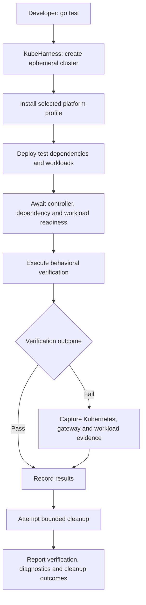
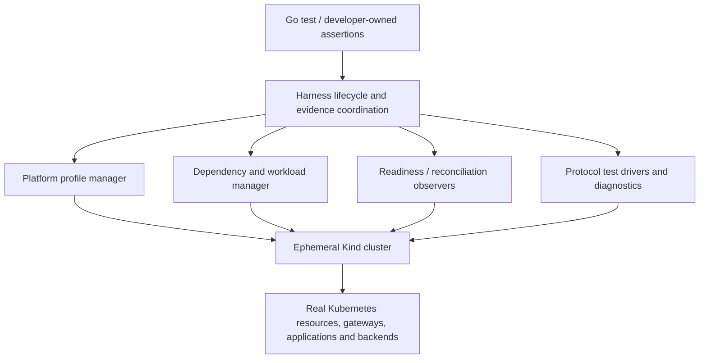

# KubeHarness

**Test real Kubernetes platform behavior with the simplicity of Go tests.**

KubeHarness is a **proposed Go-native platform integration testing harness** for reproducible, isolated Kubernetes environments. It aims to let developers express application and platform expectations while the harness provisions the cluster, deploys dependencies and workloads, waits for usable readiness, executes verifications, gathers failure evidence, and cleans up.

> **Status: S1 (owned cluster lifecycle) implemented; everything else is concept.** This repository is a clean start, not a rename or fork of [kubecheck](https://github.com/ogarciacar/kubecheck). Only `kubeharness.New(t)` exists today. The profiles, workload helpers, and experiments below are design proposals, **not implemented features**. See [CONCEPT.md](CONCEPT.md) for decisions, trade-offs, candidate experiments, and planning inputs.

## Quick start (implemented today)

Requires Go 1.27 and a running Docker daemon. No `kind` binary or cloud account is needed.

```go
package orders_test

import (
    "testing"

    "github.com/ogarciacar/kubeharness"
    metav1 "k8s.io/apimachinery/pkg/apis/meta/v1"
    "k8s.io/client-go/kubernetes"
)

func TestCluster(t *testing.T) {
    h := kubeharness.New(t) // owned Kind cluster, deleted via t.Cleanup
    client := kubernetes.NewForConfigOrDie(h.RESTConfig())
    nodes, err := client.CoreV1().Nodes().List(t.Context(), metav1.ListOptions{})
    if err != nil {
        t.Fatal(err)
    }
    t.Logf("%d nodes", len(nodes.Items))
}
```

Each run logs one report line with setup, test, and cleanup outcomes as separate fields. `go test` shows it with `-v` or when the test fails:

```text
kubeharness cluster=kh-443ca88f073e-10066 phase=ready cause=ok cleanup=succeeded remaining=0 create=7.9s ready=16.8s delete=460ms
```

A cleanup that fails or can't be confirmed fails the test and prints a `docker rm` command that removes it. Before setup starts, the cluster name and that command also go to stderr. If you stop `go test` with Ctrl-C, cleanup does not run, and `go test ./...` throws away the test binary's output. Run `hack/leaks.sh` afterwards to list what was left behind.

- `go test ./...` runs the lifecycle fault matrix against a fake provider. No Docker needed.
- `go test -tags e2e ./...` runs against real Kind (kind v0.33.0, Kubernetes v1.37.0).
- `hack/leaks.sh` reports leftover `kh-*` clusters. It never deletes.
- `hack/screen.sh [runs]` repeats the e2e suite and tallies pass, fail, and leaks.

## The problem

A unit test cannot prove that a real service works behind a Kubernetes Gateway, reaches its database, respects mesh security policies, or survives a gateway's upstream failure. Yet conventional end-to-end tests often require developers to operate shared clusters, install controllers, coordinate namespaces and ports, write retry loops, and manually collect diagnostics.

**KubeHarness proposes a different boundary:** Kubernetes is an *owned, disposable test dependency*, not an external environment the developer must maintain.

## Intended experience

```go
// PROPOSED API SKETCH — does not compile against this repository.
func TestCreateOrder(t *testing.T) {
    h := kubeharness.New(t,
        kubeharness.WithProfile("gateway-api"), // Envoy Gateway
    )

    h.Deploy("testdata/postgres")
    h.WaitReady("postgres")
    h.RunJob("testdata/migrations")
    h.Deploy("testdata/orders")
    h.WaitReady("orders")

    response := h.Gateway().Post("/orders", orderFixture)
    response.ExpectStatus(201)

    // Verify persisted state.
    // Diagnostics on failure and cleanup via t.Cleanup().
}
```

The final API, error handling, ownership model, and cleanup contract will be designed and validated incrementally.

## Conceptual execution flow



## Platform-profile roadmap

A **platform profile** is a versioned recipe for installing and preparing a particular infrastructure topology in a newly created Kubernetes cluster. The test lifecycle and basic verification primitives should remain independent of the chosen controller.

| Priority | Profile | Proposed infrastructure | Example behavior |
| --- | --- | --- | --- |
| P0 | `minimal` | Kind, native Kubernetes | Orders service + PostgreSQL; readiness; isolation |
| P0 | `gateway-api` | **Envoy Gateway (default gateway controller)** | HTTPRoute routing; cross-namespace permissions; reconfiguration |
| P1 | `gateway-agentgateway` | Agentgateway's Kubernetes controller | MCP tool discovery, authorization, federation |
| P2 | `mesh-istio` | Istio; no gateway required | Service identity; strict mTLS; traffic shifting |
| P2 | `gateway-agent-router` | Envoy Gateway + Agent Router | Model routing; provider fallback; token budgets |

**Important:** Gateway API is a Kubernetes API and resource model, **not a built-in traffic proxy**. The default `gateway-api` profile installs Envoy Gateway. The Agentgateway profile installs its **own controller**, not an unnecessary second Envoy Gateway instance. Agent Router is an extension that **does** rely on Envoy Gateway.

## Example verification scenarios

Each profile has three candidate experiments documented with hypotheses, observable oracles, required fixtures, and evidence expectations in [CONCEPT.md](CONCEPT.md#verification-experiment-catalog).

- **M01:** Provision Orders + PostgreSQL, run migrations, create an order, verify persistence.
- **G02:** Verify cross-namespace Gateway API routing fails without `ReferenceGrant` and works when granted.
- **A02:** Verify an authenticated MCP client sees and invokes only its authorized tools.
- **I01:** Verify permitted service-to-service calls succeed and unauthorized service identities are denied.
- **R02:** Force a primary mock LLM backend to fail and verify configured Agent Router fallback.

A successful scenario is not enough: the harness must also prove **reproducibility, failure diagnosis, correct resource ownership, and cleanup**.

## Proposed building blocks



The harness should **orchestrate** actual PostgreSQL, Redis, HTTP and MCP servers, rather than implement their behavior. Controller-specific details belong in profile adapters; common assertions target observable outcomes.

## Boundaries and design commitments

- **v1.x:** KubeHarness owns the lifetime of every cluster it creates. A failed test must not silently leak infrastructure. No support for attaching to existing clusters.
- **v2.0.0:** Investigate testing against existing staging Kubernetes clusters, including RBAC, shared-resource safety, ownership, namespace isolation, and read-only versus mutating actions. **Explicitly deferred.**
- **Go-first:** The initial user interface is a Go library integrated with `testing.T`, not a general CI product or necessarily a CLI.
- **Real systems, deterministic inputs:** Use local fake HTTP/LLM/MCP services for reliable protocol and routing experiments. Avoid cloud credentials and live model billing in the reference suite.
- **Gateway API-first:** Standard Gateway API resources where possible; controller-specific CRDs only inside compatible profiles.
- **Evidence-first failure reporting:** Preserve resource conditions, events, logs, request/response observations, and lifecycle errors where relevant, with secret redaction.
- **Progressive complexity:** Establish a dependable minimal fixture before implementing gateways, AI profiles, or a mesh.
- **No guarantee of production equivalence:** Single-node ephemeral Kind environments establish specific integration behavior, not cloud/load/storage parity.

## Planned development sequence

1. **Lifecycle foundation:** Create/destroy an owned Kind cluster; safe partial-failure rollback, cancellation/deadlines, `t.Cleanup` integration, and verifiable cleanup.
2. **M01 vertical slice:** Orders + PostgreSQL + migration Job + end-to-end assertion + failure diagnostics.
3. **Gateway API profile:** Install pinned Envoy Gateway; implement G01/G02/G03 with controller status and data-plane checks.
4. **Agentgateway profile:** Add deterministic MCP fixtures, authorization and federation scenarios.
5. **Istio and Agent Router profiles:** Add only after core interfaces and experiment evidence support the extension.

The sequencing is a **planning proposal**, not a completed implementation or release commitment.

## Planning with pstack

[CONCEPT.md](CONCEPT.md) is the source document for planning. It records the intended system boundary, state machines, requirements, non-goals, profile model, experiment catalog, evidence and quality gates, engineering risks, and open design questions.

When planning a slice using pstack, require a review of the concept before generating tasks. Ask for: an explicit slice boundary, behavioral contracts and invariants, architecture alternatives, executable acceptance scenarios, failure and cleanup tests, dependency versions, and measurable success criteria. Avoid coding multiple profiles before the lifecycle and M01 contracts are proven.

## Inspiration and references

- [Kind](https://kind.sigs.k8s.io/)
- [Kubernetes Gateway API](https://gateway-api.sigs.k8s.io/)
- [Envoy Gateway](https://gateway.envoyproxy.io/)
- [Agentgateway repository](https://github.com/agentgateway/agentgateway), especially [MCP authorization](https://github.com/agentgateway/agentgateway/tree/main/examples/mcp-authorization) and [multiplexing](https://github.com/agentgateway/agentgateway/tree/main/examples/mcp-multiplex)
- [Agent Router repository](https://github.com/theagentrouter/agent-router), especially [provider fallback](https://github.com/theagentrouter/agent-router/tree/main/examples/provider_fallback) and [token rate limiting](https://github.com/theagentrouter/agent-router/tree/main/examples/token_ratelimit)
- [Istio](https://istio.io/latest/docs/)

## License

[Apache License 2.0](LICENSE).